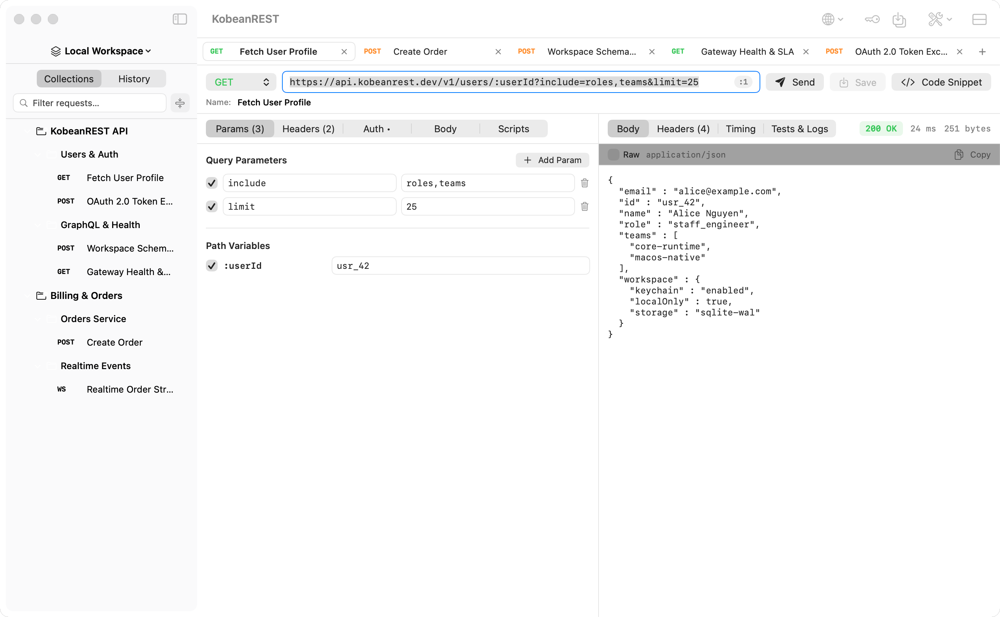
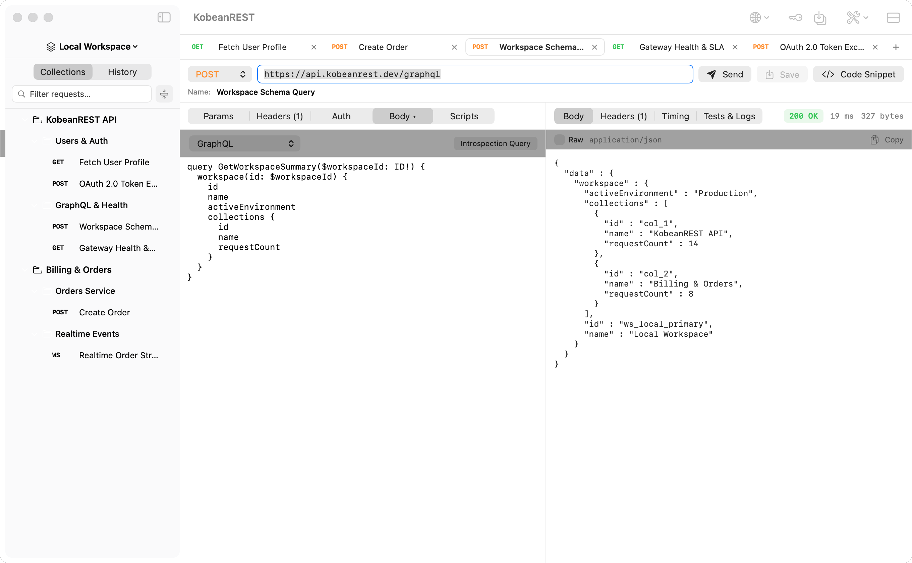
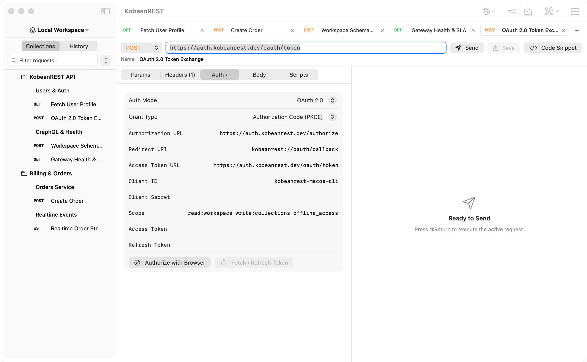
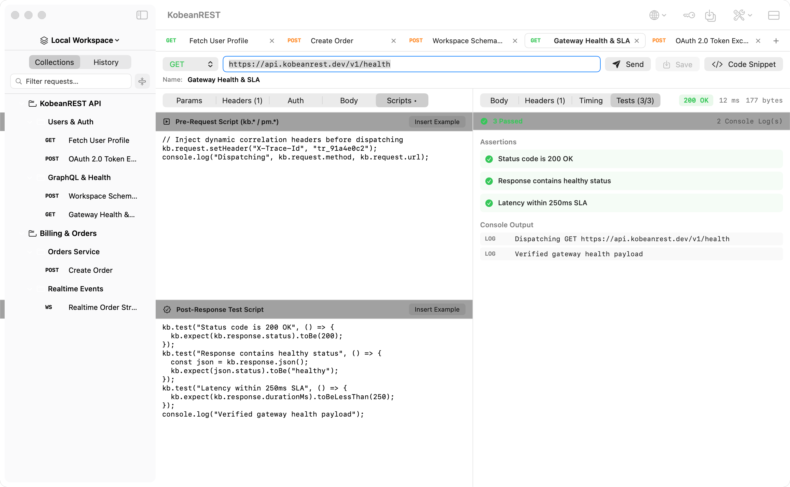
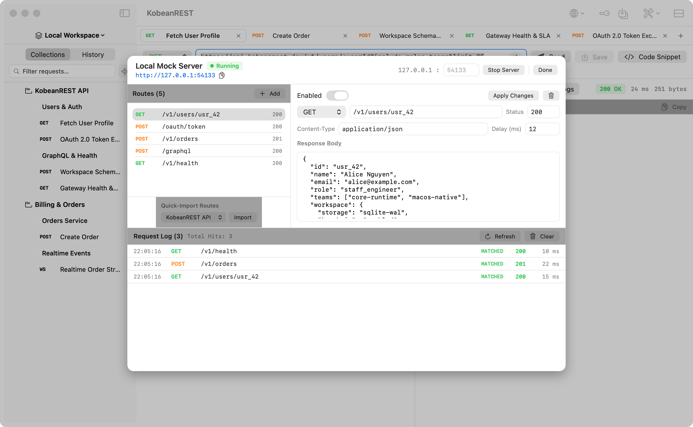
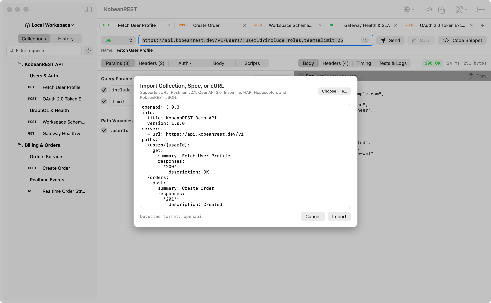
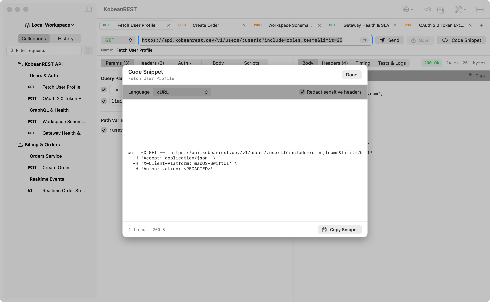
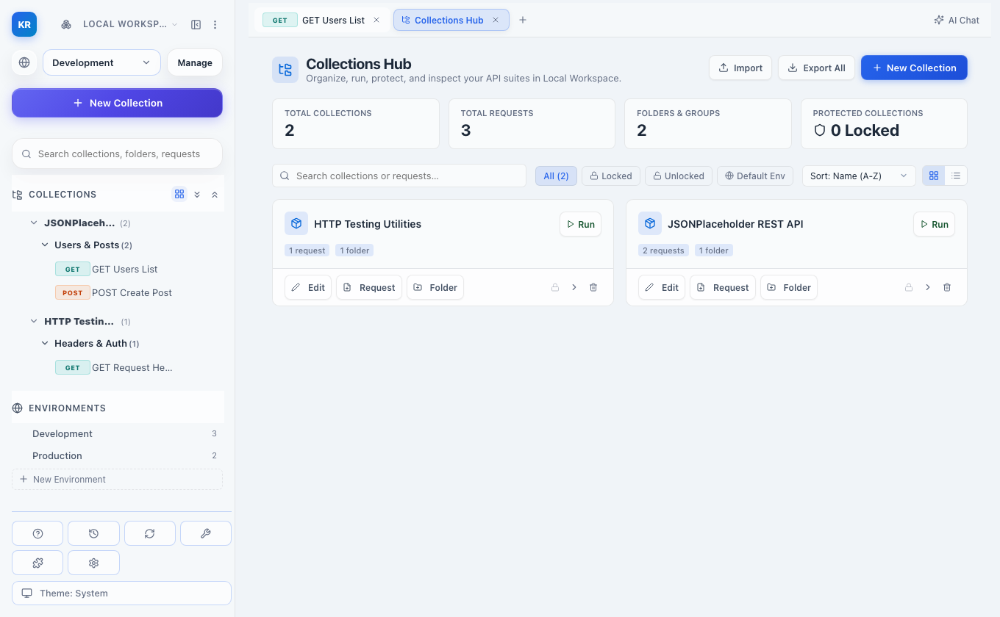
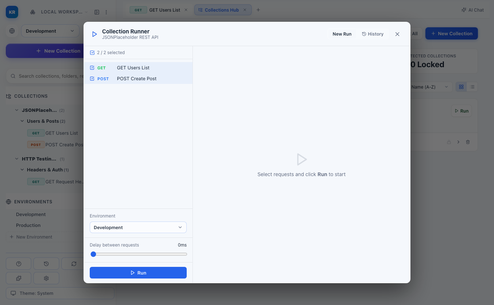

<div align="center">

# KobeanREST

**Local-first native desktop API client powered by a shared Rust engine.**

Zero cloud telemetry. Zero account walls. Built for speed with SwiftUI on macOS and Tauri on Windows & Linux.

[](https://github.com/thienng-it/KobeanREST/releases)
[](LICENSE)
[](#downloads--installation)
[](#security--local-first-guarantee)

[Features](#highlights) · [macOS Gallery](#macos-native-app) · [Downloads](#downloads--installation) · [Architecture](#architecture) · [Build & Test](#development--building) · [Security](#security--local-first-guarantee)

</div>

---

<div align="center">
  
  <br />
  <sub><b>Native macOS SwiftUI Workbench</b> — multi-tab request tabs with drag-and-drop reordering, bi-directional URL & parameter sync, JSON syntax viewer, and local SQLite persistence.</sub>
</div>

---

## Highlights

| Category | Capabilities |
| :--- | :--- |
| **Protocols & Payloads** | REST (GET/POST/PUT/PATCH/DELETE/HEAD/OPTIONS/custom), JSON, GraphQL with introspection template, WebSocket live streams, form-urlencoded, multipart, and raw bodies |
| **Native macOS Experience** | SwiftUI + AppKit split-pane workbench, horizontal/vertical layouts, Light & Dark modes, drag-and-drop tab reordering, collapsible collection folders, and `⌘`-shortcuts |
| **Auth & Secret Vault** | Bearer, Basic, API Key, OAuth 2.0 (Authorization Code + PKCE, Client Credentials, Refresh) stored in macOS Keychain (`crates/kobean-core` encrypted vault fallback) |
| **Automation & Mocking** | Pre-request & post-response test scripts (`kb.*` / `pm.*` assertions + console logs), Collection Runner, and built-in local Rust HTTP Mock Server |
| **Developer Workflow** | Universal importer (OpenAPI 3.0, Postman v2.1, Insomnia, HAR, Hoppscotch, cURL), 6-language code snippet generator, MCP Tools Inspector, and DNS/TCP/TLS timing waterfall |

---

## macOS Native App

### Workbench, Appearance & Protocols

<table>
  <tr>
    <td width="50%" valign="top">
      
      <p align="center"><b>Native Dark Mode</b><br /><sub>JSON request editor with live formatting alongside color-coded <code>201 Created</code> response payloads.</sub></p>
    </td>
    <td width="50%" valign="top">
      
      <p align="center"><b>GraphQL Studio</b><br /><sub>Dedicated GraphQL body editor with one-click introspection query template and typed JSON output.</sub></p>
    </td>
  </tr>
  <tr>
    <td width="50%" valign="top">
      
      <p align="center"><b>WebSocket Live Stream</b><br /><sub>Bidirectional Text and UTF-8 / Hex frame composer, ping controls, and live timestamped frame log.</sub></p>
    </td>
    <td width="50%" valign="top">
      
      <p align="center"><b>Query & Path Parameter Sync</b><br /><sub>Live two-way sync between <code>?key=value</code> query strings, <code>:path</code> tokens, and inspected response headers.</sub></p>
    </td>
  </tr>
</table>

### Auth, Scripting & Execution Insights

<table>
  <tr>
    <td width="50%" valign="top">
      
      <p align="center"><b>OAuth 2.0 & PKCE Auth</b><br /><sub>Configurable Authorization Code + PKCE, Client Credentials, Bearer, Basic, and API Key flows.</sub></p>
    </td>
    <td width="50%" valign="top">
      
      <p align="center"><b>Scripts & Test Assertions</b><br /><sub>Run JavaScript pre-request mutators and post-response <code>kb.test()</code> / <code>pm.test()</code> assertions with console logs.</sub></p>
    </td>
  </tr>
  <tr>
    <td width="50%" valign="top">
      
      <p align="center"><b>History & Timing Waterfall</b><br /><sub>Redacted execution history paired with per-stage DNS, TCP, TLS, and request latency bars.</sub></p>
    </td>
    <td width="50%" valign="top">
      
      <p align="center"><b>Collection Runner</b><br /><sub>Sequential batch execution across collections/folders with environment overrides and assertion pass summaries.</sub></p>
    </td>
  </tr>
</table>

### Mocking, Environments, Import & Tooling

<table>
  <tr>
    <td width="50%" valign="top">
      
      <p align="center"><b>Built-in Rust Mock Server</b><br /><sub>Local HTTP mock server inside <code>kobean-core</code> with route matching, custom status/latency, and live hit logs.</sub></p>
    </td>
    <td width="50%" valign="top">
      
      <p align="center"><b>Environments & Keychain Secrets</b><br /><sub>Switchable environment profiles where sensitive tokens are stored in macOS Keychain, never plaintext SQLite.</sub></p>
    </td>
  </tr>
  <tr>
    <td width="50%" valign="top">
      
      <p align="center"><b>Universal Importer</b><br /><sub>Auto-detect and import cURL, OpenAPI 3.0, Postman v2.1, Insomnia, HAR, Hoppscotch, and KobeanREST JSON.</sub></p>
    </td>
    <td width="50%" valign="top">
      
      <p align="center"><b>Code Snippet Generator</b><br /><sub>Export requests to cURL, Python, JavaScript, Swift, HTTPie, or Go with one-click secret redaction.</sub></p>
    </td>
  </tr>
  <tr>
    <td width="50%" valign="top">
      
      <p align="center"><b>MCP Tools Inspector</b><br /><sub>Inspect and run local KobeanREST MCP tools directly against your SQLite workspace.</sub></p>
    </td>
    <td width="50%" valign="top">
      
      <p align="center"><b>Native Settings & Storage Info</b><br /><sub>Configure theme, response line wrapping, export/log redaction, and inspect SQLite & Keychain status.</sub></p>
    </td>
  </tr>
</table>

<details>
<summary><b>Cross-Platform Desktop UI (Windows & Linux via Tauri)</b></summary>

KobeanREST also ships a cross-platform desktop client sharing the exact same Rust core (`crates/kobean-core`) alongside a React/TypeScript frontend (`src/renderer/`) and VS Code extension (`vscode-extension/`).

| Workbench | Collections & Environments | Collection Runner & Mock |
| :---: | :---: | :---: |
|  |  |  |

</details>

---

## Downloads & Installation

Pre-built signed binaries and checksums are published on [**GitHub Releases**](https://github.com/thienng-it/KobeanREST/releases):

| Platform | Package Format | Notes |
| :--- | :--- | :--- |
| **macOS** | `.dmg` / `.app` | Native SwiftUI (`macos/`) and Tauri universal desktop builds (Apple Silicon & Intel) |
| **Windows** | `.msi` / `.exe` | 64-bit Windows 10 / 11 |
| **Linux** | `.AppImage` / `.deb` | Ubuntu, Fedora, Debian, Arch (`x86_64`) |

Every release includes `SHA256SUMS.txt`. See [docs/download.md](docs/download.md) for checksum verification steps and troubleshooting.

---

## Architecture

A single Rust workspace powers HTTP networking, persistence, secret resolution, importing, and mocking across both the native macOS SwiftUI frontend (via UniFFI XCFramework) and the cross-platform Tauri shell:

```
┌────────────────────────────────────────────────────────────────────────────┐
│                             Presentation Layer                             │
│    macos/ (SwiftUI + AppKit)      │      src/renderer/ (React + Tauri)     │
└─────────────────┬─────────────────┴───────────────────┬────────────────────┘
                  │ UniFFI XCFramework                  │ Tauri IPC Commands
┌─────────────────▼─────────────────────────────────────▼────────────────────┐
│                       crates/kobean-ffi  &  src-tauri                      │
└─────────────────────────────────────┬──────────────────────────────────────┘
                                      │
┌─────────────────────────────────────▼──────────────────────────────────────┐
│                             crates/kobean-core                             │
│   HTTP Client (reqwest) · SQLite (WAL) · Keychain/Vault · Mock · Importer  │
└────────────────────────────────────────────────────────────────────────────┘
```

| Module | Path | Purpose |
| :--- | :--- | :--- |
| **Rust Core** | [`crates/kobean-core`](crates/kobean-core) | Shared HTTP execution engine, SQLite WAL persistence, Keychain/AES-GCM vault, importers, mock server |
| **UniFFI Bridge** | [`crates/kobean-ffi`](crates/kobean-ffi) | Swift & foreign-language bindings exposing `kobean-core` as `KobeanCore.xcframework` |
| **Native macOS App** | [`macos/`](macos/) | Swift 6 / SwiftUI desktop workbench (`KobeanREST.xcodeproj` generated via `xcodegen`) |
| **Tauri Host & UI** | [`src-tauri/`](src-tauri/) · [`src/renderer/`](src/renderer/) | Cross-platform desktop shell and TypeScript/React workbench |
| **VS Code Extension** | [`vscode-extension/`](vscode-extension/) | In-editor API client integration for VS Code |
| **Contracts & Docs** | [`tests/`](tests/) · [`docs/`](docs/) | Release/contract verification suites and ADRs |

---

## Development & Building

### Prerequisites

- **Rust** (stable toolchain via `rustup`)
- **Node.js** 20+ (for contract tests and Tauri frontend)
- **macOS native builds**: Xcode 16+, macOS 15+ SDK, and [`xcodegen`](https://github.com/yonaskolb/XcodeGen)

### Quick Commands

```bash
# Build native macOS SwiftUI app (compiles Rust XCFramework, generates Xcode project, opens app)
npm run macos

# Run native macOS Swift unit tests
xcodebuild test \
  -project macos/KobeanREST.xcodeproj \
  -scheme KobeanREST \
  -destination 'platform=macOS' \
  -derivedDataPath macos/DerivedData \
  -only-testing:KobeanRESTTests \
  CODE_SIGNING_ALLOWED=NO

# Regenerate macOS showcase screenshots
TEST_RUNNER_KOBEAN_CAPTURE_SCREENSHOTS_DIR="$PWD/docs/images/macos" \
  xcodebuild test -project macos/KobeanREST.xcodeproj -scheme KobeanREST \
  -destination 'platform=macOS' -derivedDataPath macos/DerivedData \
  -only-testing:KobeanRESTTests/ScreenshotCaptureTests CODE_SIGNING_ALLOWED=NO

# Cross-platform Tauri dev / release build
npm install && npm run tauri:dev
npm run tauri:build

# Verify Rust workspace & JS contract suites
cargo test --workspace
npm test
```

---

## Security & Local-First Guarantee

- **Zero Telemetry & Zero Accounts**: No analytics SDKs, crash reporters, remote sync servers, or telemetry endpoints. Workspaces live strictly on disk in SQLite (`WAL` mode).
- **OS Keychain First**: Sensitive environment secrets, API keys, and OAuth tokens are stored in macOS Keychain / OS credential storage (with an encrypted vault fallback in `crates/kobean-core`), never in plaintext workspace tables.
- **Automatic Redaction**: Sensitive headers (`Authorization`, `Cookie`, API keys) and query credentials are redacted in history logs, exports, diagnostics, and generated code snippets by default.

For architecture decisions and roadmap milestones, see [`docs/implementation-roadmap.md`](docs/implementation-roadmap.md) and [`docs/adr/`](docs/adr/).

---

## License

Licensed under the [MIT License](LICENSE).
