<div align="center">

# ⚡ KobeanREST

**A fast, local-first desktop API client for REST, gRPC, WebSocket, Socket.IO, and GraphQL workflows.**

*No account required. No cloud sync forced. 100% local workspace ownership.*

[](https://github.com/thienng-it/KobeanREST/releases/latest)
[](LICENSE)
[](https://tauri.app)
[](macos/project.yml)
[](https://react.dev)
[](https://thienng-it.github.io/KobeanREST/)
[](https://thienng-it.github.io/KobeanREST/app/)

---

[📖 Documentation](https://thienng-it.github.io/KobeanREST/) • [🚀 Try Web Preview](https://thienng-it.github.io/KobeanREST/app/) • [📦 Download Desktop App](https://github.com/thienng-it/KobeanREST/releases/latest) • [🗺️ Roadmap](docs/implementation-roadmap.md)

<br />

<table>
  <tr>
    <td width="50%" valign="top">
      
      <p align="center"><b>Native macOS (SwiftUI + AppKit)</b><br /><sub>Zero-latency native windowing, drag-and-drop tabs, Keychain integration, and Retina dark/light modes.</sub></p>
    </td>
    <td width="50%" valign="top">
      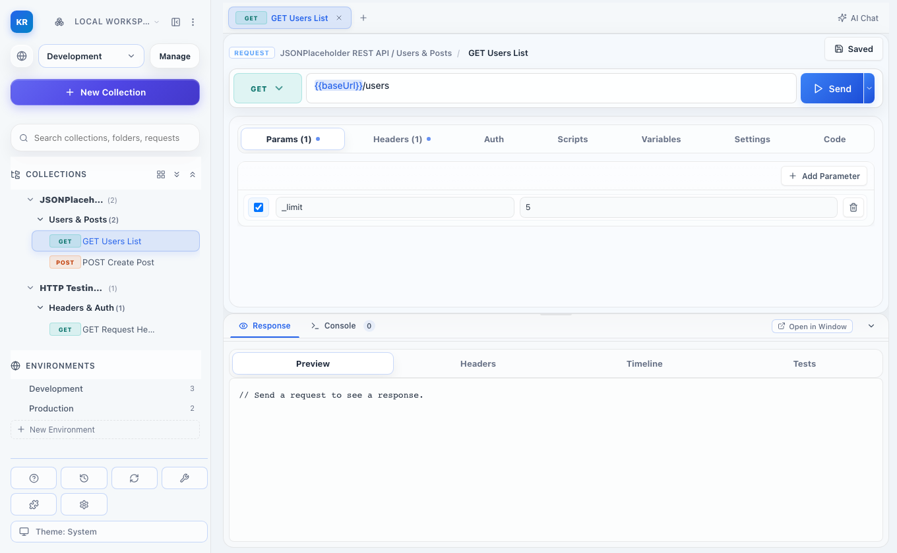
      <p align="center"><b>Cross-Platform Desktop (Tauri 2 + React)</b><br /><sub>Unified experience across Windows, Linux, macOS, and the browser Web Preview.</sub></p>
    </td>
  </tr>
</table>

</div>

---

## 🌟 Overview

**KobeanREST** is designed for software engineers, backend developers, and QA teams who need a high-performance API client without forced cloud lock-in or user registration. Download the app, launch it locally, and build, test, and debug REST, gRPC, WebSocket, Socket.IO, and GraphQL endpoints directly on your machine.

> **Local-First Contract:**
> KobeanREST has **no user accounts, no login screens, no cloud telemetry, and no required backend service.** All workspace data is stored in local SQLite databases, and secret credentials remain safely secured in your operating system's native keychain.

---

## ✨ Key Features

| Feature | Description |
| :--- | :--- |
| 🍎 **Native macOS App (SwiftUI + AppKit)** | Dedicated macOS 15+ Swift 6 desktop client powered by `KobeanFFI.xcframework` with multi-tab drag-and-drop reordering, collapsible folders, Light/Dark themes, and shared SQLite/Keychain parity. |
| ⚡ **gRPC & Protobuf RPC Client** | Native gRPC execution engine supporting Unary and Streaming calls with `.proto` IDL loading, service/method selection, sample payload synthesis, custom metadata headers, and latency metrics. |
| 🔌 **WebSocket & Socket.IO Streaming** | Real-time bidirectional message streaming with incoming/outgoing chronological timeline inspector, event emitters, Text/UTF-8/Hex payloads, and connection state indicators. |
| 📐 **GraphQL Studio & Inspection** | Query and variables editor with syntax highlighting, schema introspection support, and strict GraphQL-over-HTTP error & data status reporting (`GraphQL OK`, `GraphQL Errors`). |
| 🛠️ **Local Mock Server & Starter Templates** | Built-in multi-route HTTP/REST & gRPC mock server with template presets (E-Commerce, OpenAI LLM, DevOps Health, Greeter, Echo Streaming), custom delays, and live hit logs. |
| 📥 **Universal API Importer** | 1-click import from cURL, Postman v2.1, OpenAPI/Swagger 3.x, Insomnia, HAR, Hoppscotch, and `.http` files with draft preservation. |
| 🤖 **AI Assistant & MCP Tools** | Built-in local/cloud AI Assistant (Ollama, OpenAI, Anthropic, Gemini, Groq, OpenRouter) plus a native MCP Tools Inspector running directly against local workspace storage. |
| 🧩 **Extensible Plugin System** | Modular plugin runner with a rich built-in catalog (UUID Request ID, HMAC Signer, Response Time Logger, Rate Limit Checker, JSON Extractor, Status Asserters). |
| 🔐 **Keychain Secret Protection** | Sensitive values (API keys, OAuth 2.0 + PKCE tokens, client secrets) stay outside SQLite in OS Keychain / encrypted vault storage. |
| 🏃 **Collection Runner & 6-Lang Snippets** | Execute entire collections sequentially with assertion summaries, and export clean redacted code snippets (cURL, Python, JavaScript, Swift, HTTPie, Go). |
| 📜 **Pre & Post Request Scripts** | Dynamic JavaScript execution environment (`kb.*` / `pm.*`) with live console logs, assertions, and variable injection. |
| 📊 **QA Dashboard** | Real-time test analytics, flakiness governance, and daily telemetry drilldown for automated tests. |
| 🌐 **Live Web Preview** | Try KobeanREST instantly in any modern web browser without installing local desktop binaries. |

---

## 🍎 Native macOS App Gallery (`macos/`)

<div align="center">
  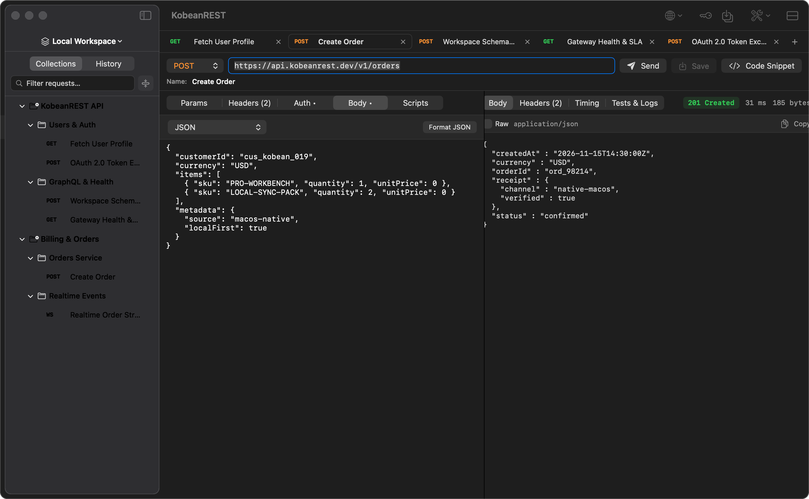
  <br />
  <sub><b>Native macOS Dark Mode:</b> JSON body composer alongside syntax-formatted <code>201 Created</code> response inspection.</sub>
</div>

<br />

<table>
  <tr>
    <td width="50%" valign="top">
      
      <p align="center"><b>GraphQL Studio</b><br /><sub>GraphQL query editor with one-click introspection template and formatted response output.</sub></p>
    </td>
    <td width="50%" valign="top">
      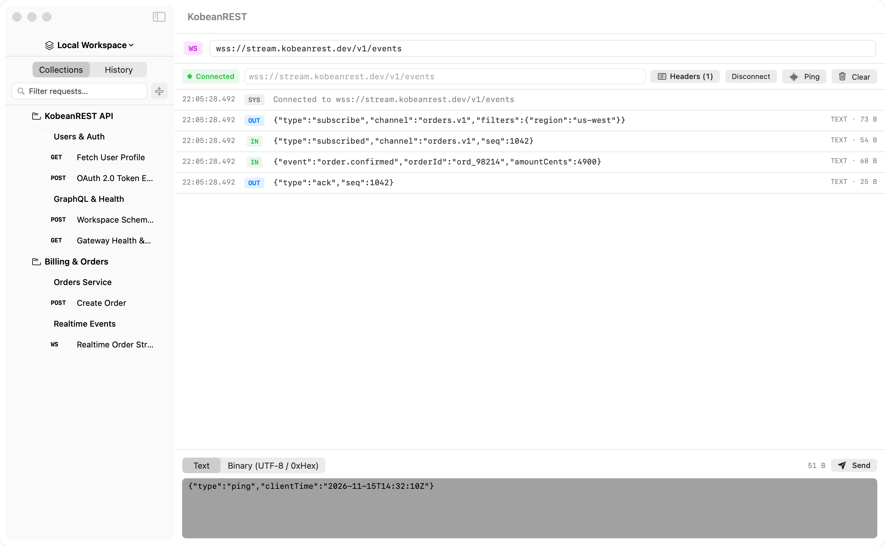
      <p align="center"><b>WebSocket Workbench</b><br /><sub>Text and UTF-8 / Hex frame composer with live inbound/outbound stream timeline.</sub></p>
    </td>
  </tr>
  <tr>
    <td width="50%" valign="top">
      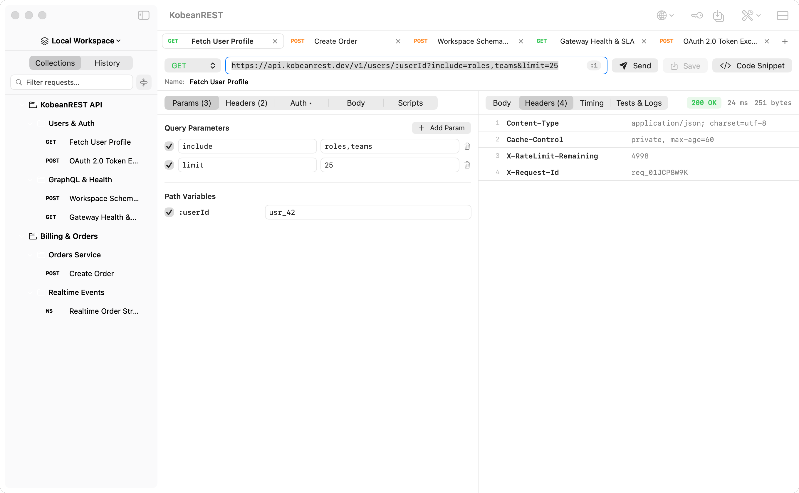
      <p align="center"><b>Query & Path Parameter Sync</b><br /><sub>Live two-way sync between <code>?key=value</code> query strings, <code>:path</code> tokens, and response headers.</sub></p>
    </td>
    <td width="50%" valign="top">
      
      <p align="center"><b>OAuth 2.0 & PKCE Auth</b><br /><sub>Native <code>ASWebAuthenticationSession</code> PKCE, Client Credentials, Bearer, Basic, and API Key auth.</sub></p>
    </td>
  </tr>
  <tr>
    <td width="50%" valign="top">
      
      <p align="center"><b>Scripts & Test Assertions</b><br /><sub>Sandboxed <code>JavaScriptCore</code> pre-request and <code>kb.test()</code> / <code>pm.test()</code> post-response runner.</sub></p>
    </td>
    <td width="50%" valign="top">
      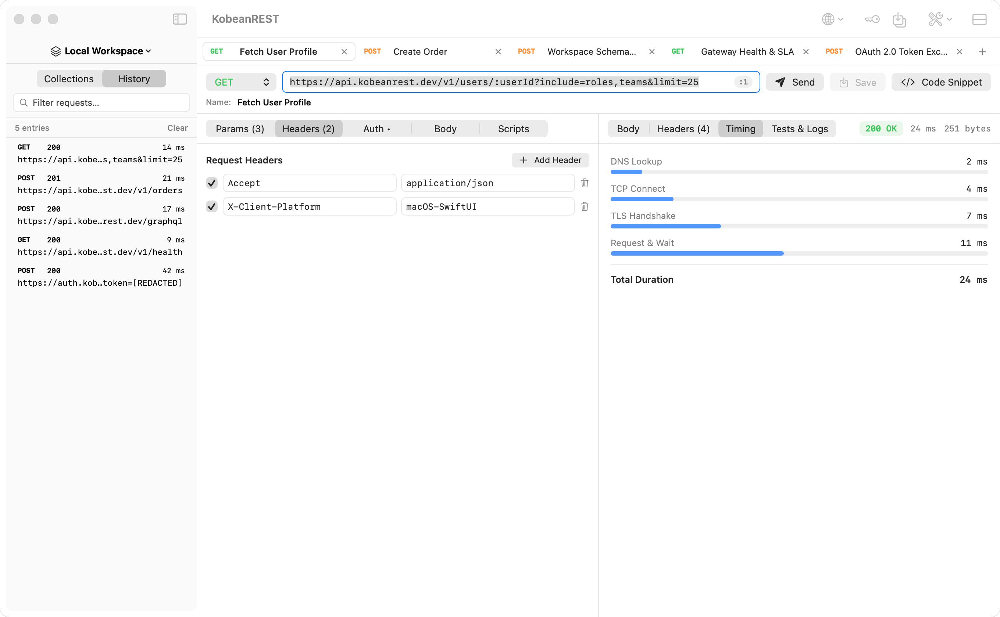
      <p align="center"><b>History & Timing Waterfall</b><br /><sub>Secret-redacted history log paired with DNS, TCP, TLS, and wait latency stages.</sub></p>
    </td>
  </tr>
  <tr>
    <td width="50%" valign="top">
      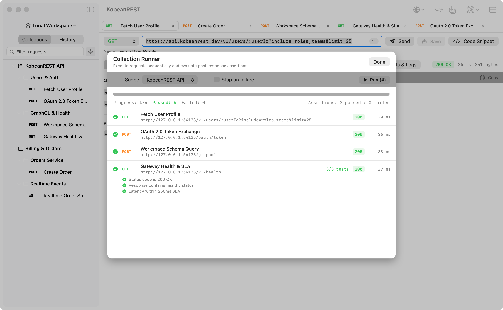
      <p align="center"><b>Collection Runner</b><br /><sub>Sequential batch runner across collections & folders with assertion pass summaries.</sub></p>
    </td>
    <td width="50%" valign="top">
      
      <p align="center"><b>Local Rust Mock Server</b><br /><sub>Loopback HTTP mock server with live route editing, custom delays, and request hit logs.</sub></p>
    </td>
  </tr>
  <tr>
    <td width="50%" valign="top">
      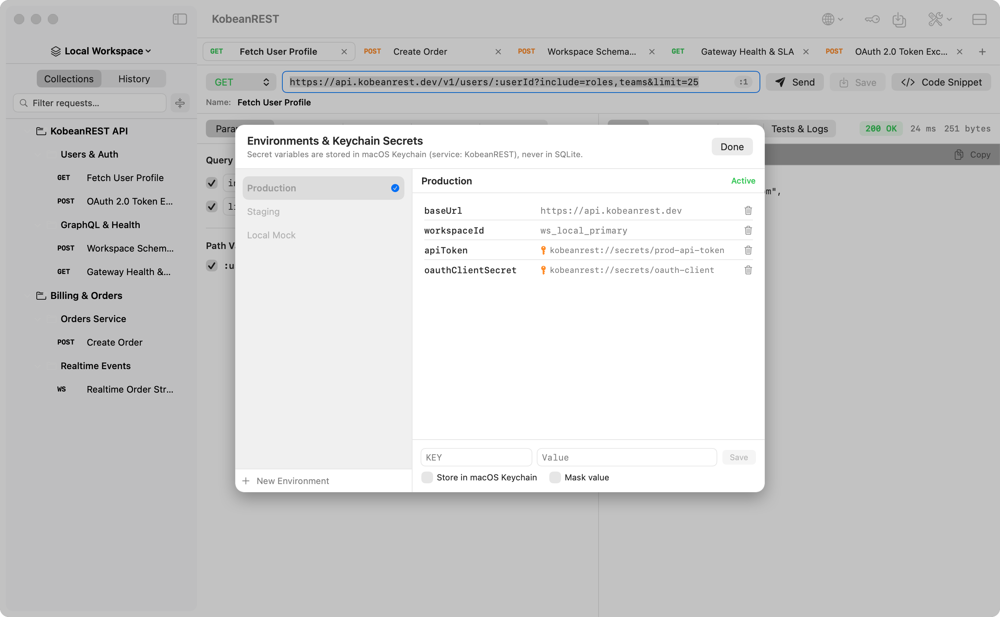
      <p align="center"><b>Environments & Keychain Secrets</b><br /><sub>Environment variable switcher keeping secrets in macOS Keychain, never plaintext SQLite.</sub></p>
    </td>
    <td width="50%" valign="top">
      
      <p align="center"><b>Universal Importer</b><br /><sub>Auto-detect cURL, OpenAPI 3.0, Postman v2.1, Insomnia, HAR, Hoppscotch, and KobeanREST JSON.</sub></p>
    </td>
  </tr>
  <tr>
    <td width="50%" valign="top">
      
      <p align="center"><b>Code Snippet Generator</b><br /><sub>Export requests to cURL, Python, JavaScript, Swift, HTTPie, and Go with secret redaction.</sub></p>
    </td>
    <td width="50%" valign="top">
      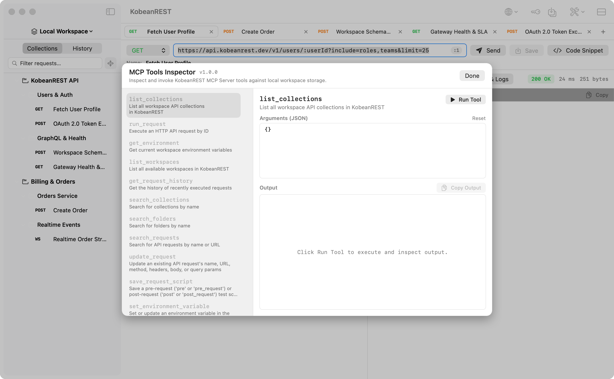
      <p align="center"><b>MCP Tools Inspector</b><br /><sub>Inspect and invoke local KobeanREST MCP tools directly against workspace SQLite storage.</sub></p>
    </td>
  </tr>
</table>

<div align="center">
  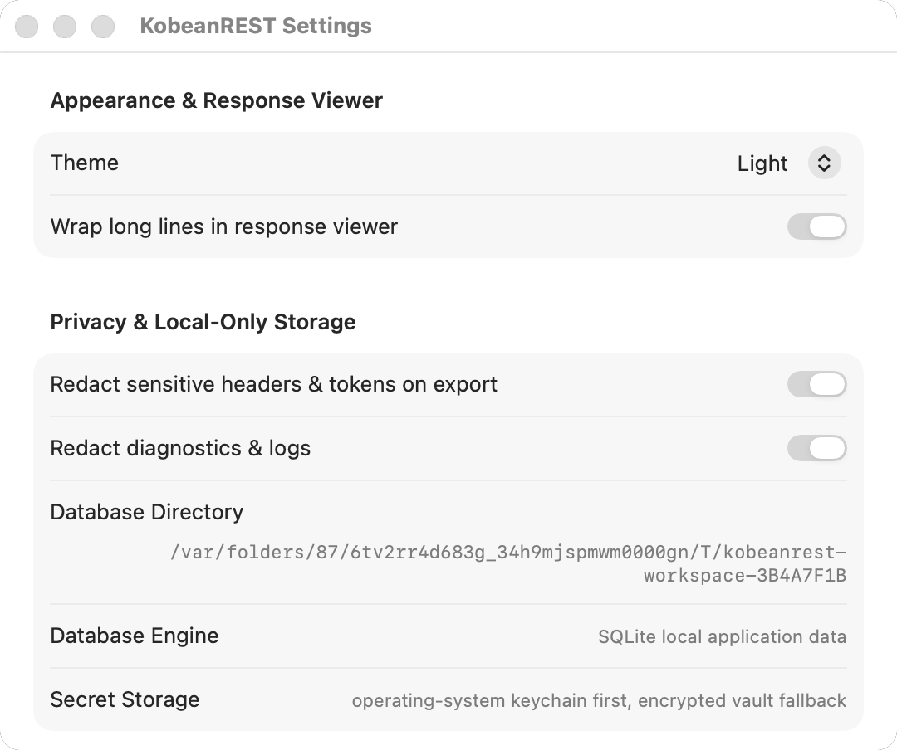
  <br />
  <sub><b>Native macOS Settings:</b> Theme selection, response wrapping, export/diagnostic redaction, SQLite WAL path, and Keychain vault status.</sub>
</div>

---

## 📸 Cross-Platform Feature Gallery (Windows, Linux & macOS Tauri)

<table>
  <tr>
    <td width="50%" valign="top">
      
      <p align="center"><b>gRPC & Protobuf Client</b><br /><sub>Interactive <code>.proto</code> loader, method selector, and decoded streaming response viewer.</sub></p>
    </td>
    <td width="50%" valign="top">
      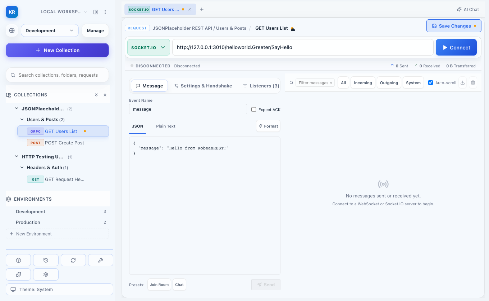
      <p align="center"><b>WebSocket & Socket.IO</b><br /><sub>Real-time bi-directional streaming inspector and interactive event emitter.</sub></p>
    </td>
  </tr>
  <tr>
    <td width="50%" valign="top">
      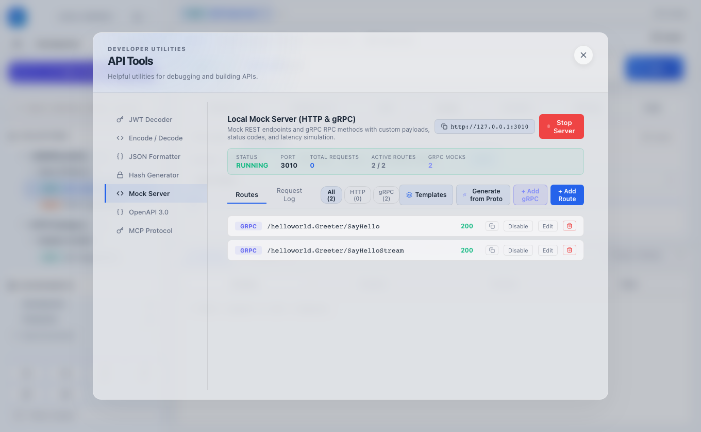
      <p align="center"><b>Local Mock Server</b><br /><sub>Built-in multi-route REST & gRPC server with pre-configured starter templates.</sub></p>
    </td>
    <td width="50%" valign="top">
      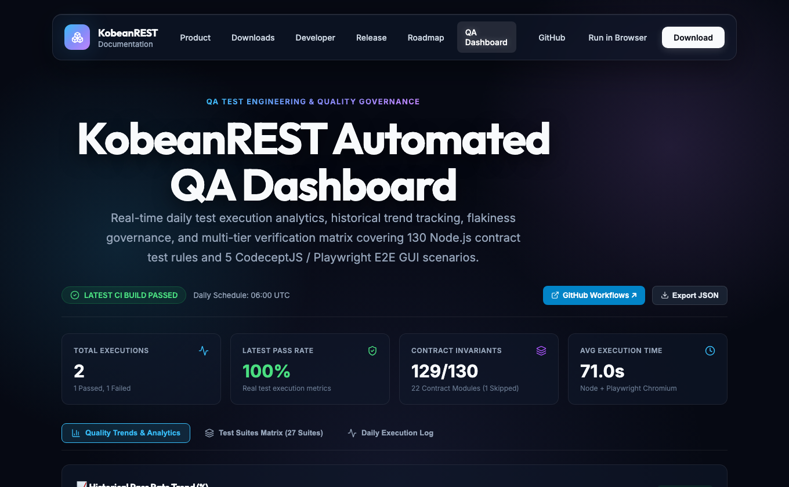
      <p align="center"><b>QA Dashboard</b><br /><sub>Real-time test analytics, suite metrics, and flakiness telemetry drilldown.</sub></p>
    </td>
  </tr>
  <tr>
    <td width="50%" valign="top">
      
      <p align="center"><b>Local Environment & Variables Editor</b><br /><sub>Keep secrets safe in your native OS keychain alongside dynamic variable scopes.</sub></p>
    </td>
    <td width="50%" valign="top">
      
      <p align="center"><b>Pre & Post Request Scripts</b><br /><sub>Dynamic execution environment with tests, assertions, and live logs.</sub></p>
    </td>
  </tr>
  <tr>
    <td width="50%" valign="top">
      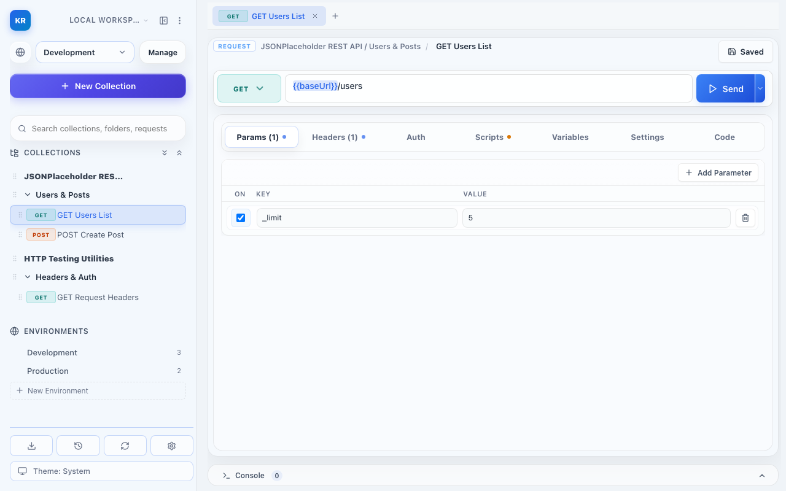
      <p align="center"><b>Interactive Query Params</b><br /><sub>Real-time bi-directional synchronization with the URL bar.</sub></p>
    </td>
    <td width="50%" valign="top">
      
      <p align="center"><b>History Viewer</b><br /><sub>Detailed logging of past requests and one-click replay functionality.</sub></p>
    </td>
  </tr>
</table>

---

## 📥 Downloads & Installation

Official cross-platform installers are published through GitHub Releases:

👉 **[Download Latest Version (GitHub Releases)](https://github.com/thienng-it/KobeanREST/releases/latest)**

| Platform | Installer Format | Architecture |
| :--- | :--- | :--- |
| **macOS** | `.dmg` (Tauri Universal & Native macOS `KobeanREST-macOS-Native.dmg`) | macOS 15+ (Apple Silicon & Intel) |
| **Windows** | `.msi` | x64 |
| **Linux** | `.AppImage` / `.deb` | x64 |

*Detailed installation instructions, checksum verification (`SHA256SUMS.txt`), and OS security notes are available in the [Download Guide](docs/download.md).*

---

## 🏗️ Architecture

```
┌──────────────────────────────┐    ┌─────────────────────────────────────┐
│   Native macOS App (macOS)   │    │  Tauri Desktop App (Win/Linux/Mac)  │
│  SwiftUI + AppKit (Swift 6)  │    │   React Renderer + Tauri 2 IPC      │
└──────────────┬───────────────┘    └──────────────────┬──────────────────┘
               │ UniFFI Static XCFramework             │
               │ (crates/kobean-ffi)                   │ Tauri Commands
               └──────────────────┬────────────────────┘
                                  ▼
               ┌──────────────────────────────────────┐
               │       Shared Rust Core (kobean-core) │
               │ SQLite (WAL), Reqwest, OS Keychain,  │
               │ Domain Engine, Mock Server, MCP      │
               └──────────────────────────────────────┘
```

| Layer | Responsibility |
| :--- | :--- |
| **Native macOS Client ([`macos/`](macos/))** | SwiftUI + AppKit workbench (macOS 15+, Swift 6 strict concurrency), keyboard-navigable sidebar tree (Collapse/Expand All, `Return` / right-click inline rename, Duplicate), drag-and-drop tab reordering, `ASWebAuthenticationSession` OAuth2 + PKCE, `JavaScriptCore` sandboxed scripts, `URLSessionWebSocketTask`, Snippet Generator, and XcodeGen project ([`macos/project.yml`](macos/project.yml)) |
| **UniFFI Bridge ([`crates/kobean-ffi`](crates/kobean-ffi))** | Static `KobeanFFI.xcframework` exposing `kobean-core` persistence, HTTP, mock server, MCP, and domain helpers to Swift |
| **Shared Rust Core ([`crates/kobean-core`](crates/kobean-core))** | Shared workspace SQLite (`WAL`, `com.kobeanrest.app/kobeanrest.sqlite`), Keychain secret vault (`service = "KobeanREST"`), HTTP client, domain resolution/import parity, loopback mock server, OpenAPI generator, and MCP tools |
| **Tauri 2 Shell ([`src-tauri/`](src-tauri/))** | Thin desktop IPC wrapper around `kobean-core` for cross-platform Windows, Linux, and macOS builds |
| **React Renderer ([`src/renderer/`](src/renderer/))** | CodeMirror editor, dynamic variable resolution `{{var}}`, theme engines |
| **VS Code Extension ([`vscode-extension/`](vscode-extension/))** | Standalone KobeanREST extension integration for VS Code |
| **Docs Portal ([`docs-site/`](docs-site/))** | GitHub Pages documentation portal |

---

## 🛠️ Development & Building

### Prerequisites
- [Node.js](https://nodejs.org/) v22+
- [Rust](https://www.rust-lang.org/) stable toolchain
- Cargo & platform build dependencies
- *(Native macOS only)* Xcode 16+ (macOS 15 SDK) and [`xcodegen`](https://github.com/yonaskolb/XcodeGen) (`brew install xcodegen`)

### Cross-Platform Tauri App

1. **Clone & Install Dependencies:**
   ```bash
   git clone https://github.com/thienng-it/KobeanREST.git
   cd KobeanREST
   npm install
   ```

2. **Run Web Renderer (Dev Mode):**
   ```bash
   npm run dev
   ```

3. **Run Tauri Desktop App:**
   ```bash
   npm run tauri dev
   ```

4. **Execute Cross-Platform Verification & Tests:**
   ```bash
   npm test               # Run contract and unit test suite
   npm run build          # Build TypeScript & Vite renderer
   npm run check:native   # Run Cargo check for Tauri desktop crate
   npm run build:docs     # Build documentation portal
   npm run check:secrets  # Perform Betterleak sensitive-data scan
   npm run check:release  # Run release preflight checks
   ```

### Native macOS Client (`macos/`)

The native macOS client shares the exact same SQLite workspace and OS Keychain store as Tauri so both clients interoperate on your local machine.

1. **One-Command Build & Launch (Release):**
   ```bash
   npm run macos
   ```
   *(Builds the Rust XCFramework, regenerates `macos/KobeanREST.xcodeproj`, compiles Release, and opens `KobeanREST.app`.)*

2. **Build Rust Core XCFramework & Swift UniFFI Bindings (Manual):**
   ```bash
   ./macos/scripts/build-rust-xcframework.sh              # Current macOS architecture
   # Or build Universal (requires `rustup target add x86_64-apple-darwin aarch64-apple-darwin`):
   ./macos/scripts/build-rust-xcframework.sh --universal
   ```

3. **Generate Xcode Project, Run Tests, or Launch Debug Build:**
   ```bash
   cd macos && xcodegen generate && cd ..

   # Run Swift unit & integration tests
   xcodebuild test \
     -project macos/KobeanREST.xcodeproj \
     -scheme KobeanREST \
     -configuration Debug \
     -destination 'platform=macOS' \
     -derivedDataPath macos/DerivedData \
     -only-testing:KobeanRESTTests \
     CODE_SIGNING_ALLOWED=NO

   # Regenerate macOS showcase screenshots
   TEST_RUNNER_KOBEAN_CAPTURE_SCREENSHOTS_DIR="$PWD/docs/images/macos" \
     xcodebuild test \
       -project macos/KobeanREST.xcodeproj \
       -scheme KobeanREST \
       -destination 'platform=macOS' \
       -derivedDataPath macos/DerivedData \
       -only-testing:KobeanRESTTests/ScreenshotCaptureTests \
       CODE_SIGNING_ALLOWED=NO

   # Fast Swift-only Debug rebuild & launch (when Rust core hasn't changed)
   xcodebuild build \
     -project macos/KobeanREST.xcodeproj \
     -scheme KobeanREST \
     -configuration Debug \
     -destination "platform=macOS,arch=$(uname -m)" \
     -derivedDataPath macos/DerivedData && \
     open macos/DerivedData/Build/Products/Debug/KobeanREST.app

   # Or open in Xcode GUI (press ⌘R to run)
   open macos/KobeanREST.xcodeproj
   ```

4. **Run Rust Core & FFI Workspace Tests:**
   ```bash
   cargo test --workspace
   ```

---

## 🔒 Security & Privacy

KobeanREST is engineered to keep your workspace data private and local:

- **Keychain-Externalized Credentials:** API keys, passwords, OAuth2 access/refresh tokens, and client secrets are stored in the OS Keychain (`service = "KobeanREST"`, referenced via `kobeanrest://secrets/...`) rather than plaintext SQLite fields.
- **Sandboxed Scripts & Native OAuth2:** On native macOS, `kb.*`/`pm.*` scripts run inside an isolated `JavaScriptCore` context with a watchdog timeout and zero Keychain secret exposure; OAuth2 uses ephemeral `ASWebAuthenticationSession` with strict PKCE `S256` and CSRF `state` verification.
- **Redacted Secret Exports & History:** Workspace exports redact secret variables, auth configs, and sensitive headers by default, and request history masks sensitive URL query tokens, `Authorization`, `Cookie`, and `Set-Cookie` headers.
- **Automated Scanning:** Source, Swift, Xcode configs, and workflows are scanned for credential leaks (`npm run check:secrets` and `betterleaks`).

---

## 📄 License

Distributed under the [MIT License](LICENSE). Created and maintained with ❤️ by **[Joseph Thien](https://github.com/thienng-it)** and **[Kobenguyent](https://github.com/kobenguyent)**.
